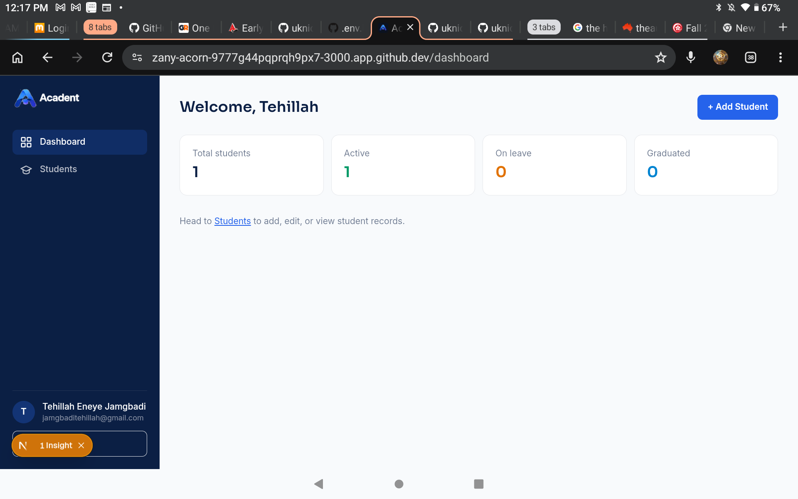
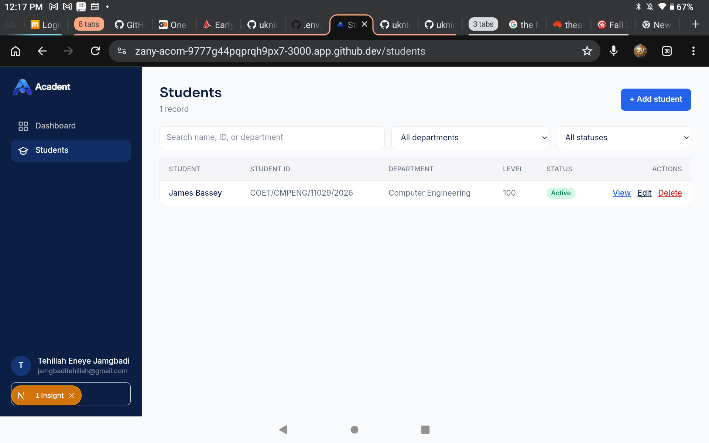
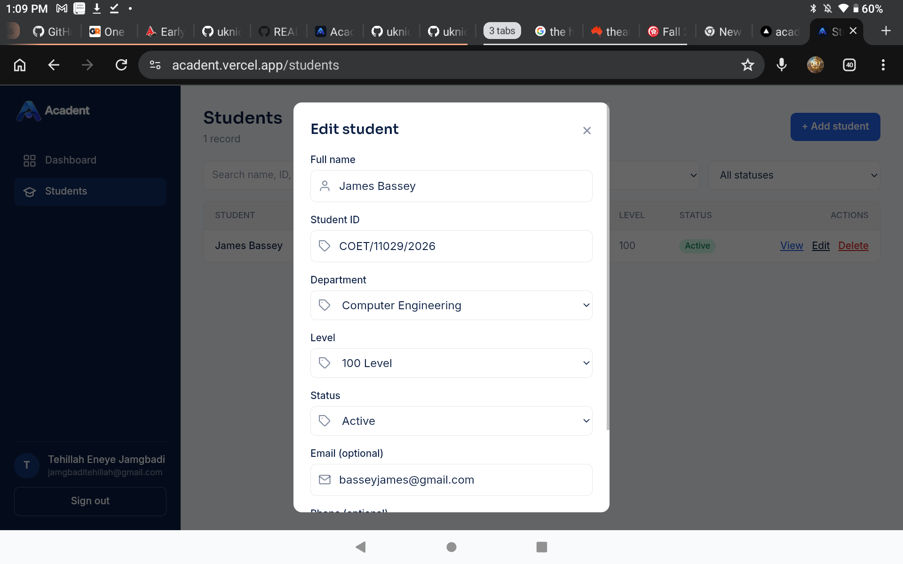
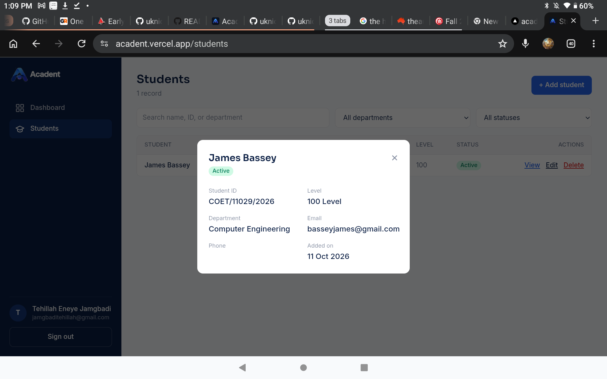

# Acadent

> Manage. Track. Empower.

Acadent is a full-stack student record management system. Staff create an account, then add, update, delete, and view student records in one place.

Built as **Task 2 (Student Management System)** of the Full Stack Development Internship at **Auspify Technologies**.

- **Live demo:** https://acadent.vercel.app/dashboard
- **Repository:** https://github.com/uknicTjstyles/acadent

## Screenshots

| Dashboard | Students |
|---|---|
|  |  |

| Add/Edit student | Student details |
|---|---|
|  |  |

## Features

**Accounts**
- Sign up and sign in with email and password
- Passwords hashed with bcrypt; sessions use signed, httpOnly cookies

**Student records**
- Add a new student (name, student ID, department, level, status, optional email and phone)
- Edit any student's details
- Delete a student, with a confirm step
- View a student's full details in one click
- Search by name, student ID, or department
- Filter by department and status

**Dashboard**
- Total student count, plus a breakdown by Active, On Leave, and Graduated

**Experience**
- Fully responsive: sidebar on desktop, hamburger menu on phones
- Card list on mobile, full table on desktop
- Toast notifications for every success and error
- Icons on all inputs, with show/hide on password fields

## Task requirements

| Requirement (Task 2) | How it is met |
|---|---|
| Design the frontend interface | Students page (list, search, filters) and Dashboard |
| Create backend APIs | REST API routes for students and auth |
| Implement database connectivity | MongoDB Atlas via Mongoose |
| Add CRUD operations | Add, edit, delete, and view student records |
| Test application functionality | Verified sign up/in, add/edit/delete/view, search and filters |

## Tech stack

| Area | Technology |
|---|---|
| Framework | Next.js (App Router), React, TypeScript |
| Styling | Tailwind CSS |
| Database | MongoDB Atlas with Mongoose |
| Authentication | jose (signed JWT cookies), bcryptjs |
| Notifications | react-toastify |
| Hosting | Vercel |

## Getting started

### Prerequisites
- Node.js 20.9 or newer
- A free [MongoDB Atlas](https://www.mongodb.com/atlas) cluster

### Setup

```bash
git clone https://github.com/YOUR-USERNAME/acadent.git
cd acadent
npm install
```

Create a `.env.local` file in the project root:

```
MONGODB_URI=mongodb+srv://<user>:<password>@<cluster>.mongodb.net/acadent?retryWrites=true&w=majority
AUTH_SECRET=<a long random string>
```

Generate a secret with:

```bash
openssl rand -base64 32
```

Start the development server:

```bash
npm run dev
```

Open http://localhost:3000.

To check a production build:

```bash
npm run build
npm start
```

### Environment variables

| Variable | Description |
|---|---|
| `MONGODB_URI` | MongoDB Atlas connection string, including the database name (`/acadent`) |
| `AUTH_SECRET` | Secret used to sign session cookies. Keep it private. |

## Project structure

```
app/
├─ (auth)/            sign-in and sign-up pages
├─ (app)/             signed-in pages with the sidebar shell
│  ├─ dashboard/
│  └─ students/
├─ api/               REST API routes
└─ layout.tsx          root layout, toasts
components/            UI components (forms, shell, student views)
lib/                   database connection, session, student helpers
models/                Mongoose models (User, Student)
public/brand/          logos
```

## API reference

All `/api/students` routes require a signed-in session.

| Method | Route | Description |
|---|---|---|
| POST | `/api/auth/register` | Create an account |
| POST | `/api/auth/login` | Sign in |
| POST | `/api/auth/logout` | Sign out |
| GET | `/api/students` | List students (`q`, `department`, `status` filters) |
| POST | `/api/students` | Add a student |
| GET | `/api/students/:id` | Get one student |
| PUT | `/api/students/:id` | Update a student |
| DELETE | `/api/students/:id` | Delete a student |

## Security notes

- Passwords are hashed with bcrypt and never stored in plain text.
- Session cookies are httpOnly, so page scripts cannot read them.
- Every student API route checks for a valid session before reading or changing data.
- Secrets live in environment variables and are never committed.

## Deployment

The app is deployed on Vercel:

1. Import the GitHub repository on Vercel.
2. Add `MONGODB_URI` and `AUTH_SECRET` as environment variables.
3. In MongoDB Atlas, allow network access from `0.0.0.0/0` so Vercel can connect.
4. Deploy. Every push to `main` redeploys automatically.

## Possible improvements

- Course enrollment and results
- Attendance tracking
- Fees and payments
- Reports and analytics

## Author

**Tehillah Eneye Jamgbadi**
Full Stack Development Intern, Auspify Technologies
